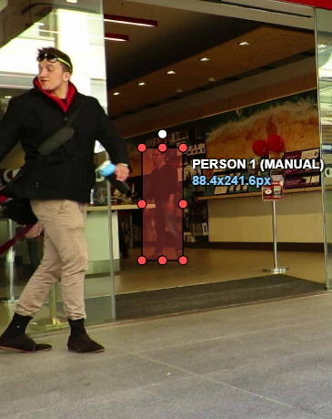
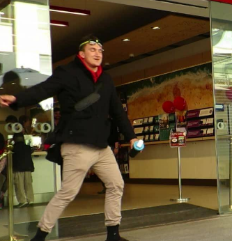
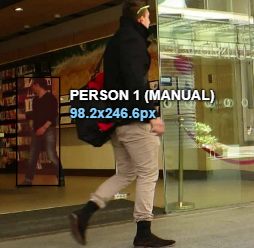

# Báo cáo cá nhân — HoVaTen-MSSV

Đổi tên file theo quy tắc `MSSV_HoTen.md`. Ví dụ: `20241234_NguyenVanAn.md`.

Đoạn video: MOT17-09, 150 frame (frame 1–150), nguồn MOTChallenge, giấy phép CC BY-NC-SA 3.0.

## 0. Thông tin học viên

- Họ tên: Nguyễn Thanh Sơn
- MSSV: 2A202603318
- Mã đề (A/B/C): Đề B | Task: DAY05-MOT17-09-B-2A202603318
- Email: thanhnguyensonjqk@gmail.com
- Link repository: https://github.com/ThanhSon2903/K5-L2-DAY05-NguyenThanhSon-2A202603318-MOTTracking(Nếu mà các anh Lab Coach không bấm vào được link github này thì mấy a thêm dấu chấm vào sau chữ `https://github.com/ThanhSon2903/K5-L2-DAY05-NguyenThanhSon-2A202603318-MOTTracking.` như này giúp em nhé tại em lỡ submit có thêm dấu chấm) 
- Giờ bắt đầu: 16h
- Giờ kết thúc: 18h30

## 1. Xem trước đoạn video (CP0)

Ghi **trước khi vẽ**, mỗi người một dòng.

| Mã | Frame xuất hiện | Frame cuối thấy được | Rẽ / dừng / đổi tốc độ ở frame | Bị che ở frame | Ghi chú |
|---|---|---|---|---|---|
| P1 |1 |150 |38 |39 |Xuất hiện từ đầu video, theo dõi gần như toàn bộ đoạn |
| P2 |1 | 150|0 |0 |Xuất hiện từ đầu và ko bị xoá |
| P3 |1 | 144|109 |111 |Có đoạn bị che khuất |
| P4 |1 | 102|109 |111 |Có đoạn bị che khuất |
| P5 |15 |150| 16|0 |Xuất hiện muộn hơn các đối tượng còn lại |

## 2. Keyframe và thời gian (CP1, CP4)

Số keyframe lấy từ kết quả `src/check_submission.py`.

| Mã | Số keyframe | Keyframe ở frame | Số frame có mặt | Keyframe / 100 frame | Thời gian (phút) | Chỗ khó |
|---|---|---|---|---|---|---|
| P1 |42 |[0, 1, 2, 3, 4, 5, 6, 7, 8, 9, 10, 11, 12, 13, 14, 15, 16, 17, 18, 19, 23, 27, 33, 35, 50, 51, 52, 54, 56, 58, 59, 64, 66, 68, 74, 85, 88, 96, 117, 123, 138, 147]  | 138|30.4 | 30 |Nhiều keyframe ở đầu video |
| P2 |47 |[0, 6, 9, 14, 18, 21, 30, 33, 37, 42, 44, 45, 46, 48, 53, 57, 62, 67, 71, 74, 78, 79, 82, 87, 89, 94, 95, 102, 104, 106, 108, 111, 116, 118, 119, 120, 122, 123, 129, 135, 137, 138, 141, 143, 144, 146, 149] |150 |31.3 |30 |Theo dõi xuyên suốt video |
| P3 |12 |[0, 9, 15, 18, 21, 26, 33, 42, 107, 137, 140, 145] |119 |8.7 |30 |Có đoạn bị che khuất |
| P4 |9 |[14, 16, 17, 24, 30, 31, 33, 34, 37, 42, 44, 53, 57, 62, 67, 71, 74, 79, 84, 87, 92, 94, 97, 102, 104, 106, 109, 112, 116, 125, 129, 130, 135, 138, 141, 143, 144, 146, 147, 149] |104 |8.7 |30 |Có đoạn bị che khất |
| P5 |40 |[14, 16, 17, 24, 30, 31, 33, 34, 37, 42, 44, 53, 57, 62, 67, 71, 74, 79, 84, 87, 92, 94, 97, 102, 104, 106, 109, 112, 116, 125, 129, 130, 135, 138, 141, 143, 144, 146, 147, 149] |136 |29.4 |30 |Nhiều thay đổi keyframe |
| **Tổng** |150 | |647 | 23.2|150 | |

Keyframe / 100 frame của cả bài = tổng keyframe ÷ tổng số frame có mặt × 100 = ...

Bạn đặt keyframe nhiều nhất ở người nào? Vì sao (người đó rẽ, dừng, lại gần camera hay bị che)?
- Em đặt keyframe nhiều nhất ở P2 với 47 keyframe, do đây là đối tượng xuất hiện xuyên suốt cả 150 frame của video. Việc đặt nhiều keyframe giúp em kiểm soát vị trí bounding box tốt hơn trong quá trình di chuyển và hạn chế sai lệch khi nội suy giữa các frame. Ngoài ra, P1 và P5 cũng có số lượng keyframe khá cao do cần theo dõi và điều chỉnh bounding box ở nhiều thời điểm

## 3. Đoạn bị che (CP2)

Người bị che: `P_1`

| Mốc | Frame |
|---|---:|
| Bắt đầu bị che một phần (bật `occluded`) |27 |
| Mất hẳn (bật `outside`) |38 |
| Hiện lại (tắt `outside`) |50 |
| Thấy rõ trở lại (tắt `occluded`) |54 |

- Thời gian khuất hẳn: 12 frame = 0.43 giây.
- Quyết định: giữ cùng ID (Không tạo track mới)
- Lý do (trả lời 3 câu: khuất bao lâu so với 60 frame, ngoại hình có khớp, chỗ hiện lại có đúng hướng và tốc độ):
1. Người chỉ bị khuất 12 frame, ngắn hơn nhiều so với mốc 60 frame nên khả năng nhận diện lại vẫn cao.
2. Ngoại hình, trang phục và vóc dáng của người xuất hiện trở lại phù hợp với đối tượng trước khi bị che.
3. Vị trí xuất hiện trở lại, hướng di chuyển và tốc độ tương đối khớp với quỹ đạo trước đó nên em quyết định tiếp tục sử dụng ID cũ.

Ảnh chụp màn hình:

## 4. Tự review ID (CP3)

Lượt 1 theo người (đi ngược từ frame 149 về 0 trên CVAT), lượt 2 theo cảnh (nhảy 10 frame). Ít nhất 3 dòng; không có lỗi thì ghi một dòng "đã kiểm hai lượt, không lỗi".

Loại lỗi dùng đúng một trong 7 mã: `id_switch`, `fragmentation`, `lost`, `merge`, `false_track`, `drift`, `flag`.

| Frame | Mã người | Loại lỗi | Mô tả một câu | Phát hiện ở lượt | Đã sửa? |
|---:|---|---|---|---|---|
|42 |P2 |drift |Bounding box bị lệch nhẹ khỏi vị trí thực tế của người khi di chuyển. |Lượt 1 |Có |
|85 |P1 |flag |Trạng thái occluded chưa được bật đúng khi người bị che khuất một phần |Lượt 1 |Có |
|100 |P5 |id_switch |ID có nguy cơ bị nhầm với người di chuyển gần đó khi hai đối tượng đi sát nhau. |Lượt 2 |Có |

Tổng hợp số lỗi theo loại:

| `id_switch` | `fragmentation` | `lost` | `merge` | `false_track` | `drift` | `flag` |
|---:|---:|---:|---:|---:|---:|---:|
| 1|0 |0 |0 |0 |1 |1 |

Lỗi nào chỉ lượt 2 (theo cảnh) mới thấy, lượt 1 (theo người) không thấy? Vì sao?

Lỗi id_switch ở P5 là lỗi em chỉ phát hiện rõ hơn trong lượt 2 khi kiểm tra tổng thể cảnh. Khi quan sát riêng từng người, em tập trung chủ yếu vào bounding box và quỹ đạo của từng track nên khó nhận ra sự nhầm lẫn giữa các đối tượng. Khi kiểm tra theo cảnh, em có thể so sánh vị trí và hướng di chuyển của nhiều người cùng lúc, từ đó phát hiện nguy cơ nhầm ID khi hai người đi gần hoặc giao nhau.

## 5. File xuất và kết quả tự kiểm (CP4)

| Kiểm tra | Kết quả |
|---|---|
| Tên file MOT 1.1 |NguyenThanhSon_mot.zip |
| Tên file CVAT for video 1.1 |NguyenThanhSon_cvat_video.zip |
| Số track ID khác nhau trong `gt/gt.txt` (phải là 5) |5 |
| Frame `outside` không có dòng trong `gt.txt` (đúng / sai) |Đúng|
| Job đã completed trên CVAT máy cá nhân | Đã completed |

Dán phần tóm tắt in ra từ `src/check_submission.py`:

Số frame in theo CVAT (bắt đầu từ 0). Trong gt.txt, frame_id = frame CVAT + 1.

=== File MOT 1.1: NguyenThanhSon_mot.zip ===
  Số track ID: 5   |   Tổng số box: 647
  [OK]        Đúng 5 track ID.

    Track | Frame có mặt | Số frame | Đoạn vắng (outside)
      1 |   0–149      |      138 | 38–49
      2 |   0–149      |      150 | -
      3 |   0–145      |      119 | 110–136
      4 |   0–103      |      104 | -
      5 |  14–149      |      136 | -

=== File CVAT for video 1.1: NguyenThanhSon_cvat_video.zip ===

  Track | Nhãn   | Frame thấy | Keyframe | KF/100 frame | Frame occluded | Lần bật outside
      0 | Person |        138 |       42 |         30.4 |             15 |               1
              Track 0: keyframe ở frame [0, 1, 2, 3, 4, 5, 6, 7, 8, 9, 10, 11, 12, 13, 14, 15, 16, 17, 18, 19, 23, 27, 33, 35, 50, 51, 52, 54, 56, 58, 59, 64, 66, 68, 74, 85, 88, 96, 117, 123, 138, 147]
  [CẢNH BÁO]  Track 0 có nhãn 'Person', lab này chỉ dùng 'person'.
      1 | Person |        150 |       47 |         31.3 |              0 |               0
              Track 1: keyframe ở frame [0, 6, 9, 14, 18, 21, 30, 33, 37, 42, 44, 45, 46, 48, 53, 57, 62, 67, 71, 74, 78, 79, 82, 87, 89, 94, 95, 102, 104, 106, 108, 111, 116, 118, 119, 120, 122, 123, 129, 135, 137, 138, 141, 143, 144, 146, 149]
  [CẢNH BÁO]  Track 1 có nhãn 'Person', lab này chỉ dùng 'person'.
      2 | Person |        119 |       12 |         10.1 |              7 |               2
              Track 2: keyframe ở frame [0, 9, 15, 18, 21, 26, 33, 42, 107, 137, 140, 145]
  [CẢNH BÁO]  Track 2 có nhãn 'Person', lab này chỉ dùng 'person'.
      3 | Person |        104 |        9 |          8.7 |              5 |               1
              Track 3: keyframe ở frame [0, 6, 9, 10, 21, 33, 42, 97, 99]
  [CẢNH BÁO]  Track 3 có nhãn 'Person', lab này chỉ dùng 'person'.
      4 | Person |        136 |       40 |         29.4 |             20 |               0
              Track 4: keyframe ở frame [14, 16, 17, 24, 30, 31, 33, 34, 37, 42, 44, 53, 57, 62, 67, 71, 74, 79, 84, 87, 92, 94, 97, 102, 104, 106, 109, 112, 116, 125, 129, 130, 135, 138, 141, 143, 144, 146, 147, 149]
  [CẢNH BÁO]  Track 4 có nhãn 'Person', lab này chỉ dùng 'person'.

  Tổng: 150 keyframe / 647 frame có mặt = 23.2 keyframe / 100 frame
  [OK]        Đọc được 5 track từ annotations.xml.

=== Tóm tắt ===
  Lỗi: 0   |   Cảnh báo: 5
  Không có lỗi định dạng. Mở CVAT xem lại từng [CẢNH BÁO]; cảnh báo đúng ý bạn thì ghi lý do vào báo cáo: Cảnh báo ở đây là class `Person` phải đặt là `person` theo đúng đề nhưng mà em vẫn để vì cũng không ảnh hưởng gì mấy đến kết quả
  
## 6. Ba câu kết

1. Nếu được gán lại, bạn sẽ đặt keyframe khác ở đâu? Vì sao?

- Nếu được thực hiện lại, em sẽ ưu tiên đặt thêm keyframe tại những thời điểm đối tượng thay đổi hướng di chuyển, thay đổi tốc độ hoặc có sự che khuất. Đây là những vị trí mà nội suy giữa hai keyframe có thể không phản ánh chính xác chuyển động thực tế.

- Em cũng sẽ kiểm tra kỹ hơn các frame nằm giữa hai keyframe để hạn chế bounding box bị lệch hoặc không bám sát đối tượng.

2. Có chỗ nào bạn không chắc "cùng ID hay ID mới"? Bạn đã quyết định và ghi chú thế nào?

- Có. Những trường hợp đối tượng bị che khuất trong một khoảng thời gian hoặc di chuyển gần những người khác khiến việc xác định ID trở nên khó khăn.

- Em không quyết định chỉ dựa vào vị trí xuất hiện mà kết hợp quan sát trang phục, vóc dáng, hướng di chuyển và tốc độ trước và sau khi bị che. Nếu có đủ cơ sở xác định là cùng một người, em giữ ID cũ. Nếu không đủ cơ sở xác định danh tính, em cần xem xét lại thay vì tùy tiện gán ID.

3. Một lỗi ID trong job của bạn (nếu không còn sót, chọn lỗi đã sửa) có thể làm xe tự lái dự đoán sai chuyển động của người đó như thế nào? Lỗi đó ảnh hưởng MOTA hay IDF1 nhiều hơn?

- Ví dụ, nếu một người đi bộ bị lỗi id_switch, hệ thống có thể nhận diện người đó thành một đối tượng mới hoặc nhầm với một người khác ở frame tiếp theo.

- Điều này khiến hệ thống tracking không duy trì được lịch sử chuyển động liên tục của người đi bộ, dẫn đến dự đoán sai hướng di chuyển, vận tốc và vị trí tương lai. Đối với xe tự lái, điều này có thể ảnh hưởng đến việc dự đoán nguy cơ va chạm và lập kế hoạch tránh người đi bộ.

- Theo em, lỗi id_switch ảnh hưởng đến IDF1 nhiều hơn, vì IDF1 đánh giá khả năng duy trì danh tính của đối tượng xuyên suốt quá trình tracking. Tuy nhiên, lỗi này cũng ảnh hưởng đến MOTA thông qua thành phần ID switches trong công thức đánh giá.

## Bonus (nếu làm)

### B1 — Hai người đi sát

...

### B2 — So cách đặt keyframe

| Cách đặt | Số keyframe | Frame trôi nhất | Ghi chú |
|---|---:|---:|---|
| Đều mỗi 30 frame | | | |
| Theo chỗ đổi hướng | | | |

...

### B3 — So với tracker có sẵn

| Frame | Mã người | Tracker làm gì | Nhãn của bạn | Giải thích (đoán rồi sửa / ghép IoU / box score thấp / ngoại hình) |
|---:|---|---|---|---|
| | | | | |
| | | | | |

## 7. Tài liệu tham khảo và công cụ AI đã dùng

- Tài liệu tham khảo:
1. MOTChallenge Format – MOT 1.1.
2. Hướng dẫn annotation và tài liệu thực hành Day 05 – Multi-Object Tracking (MOT).

- Công cụ sử dụng:
1. CVAT: Thực hiện annotation bounding box, tạo và quản lý track ID, đặt keyframe, nội suy và đánh dấu trạng thái occluded, outside.
2. Python: Chạy các script chuẩn bị dữ liệu và kiểm tra kết quả submission.
3. ChatGPT: Hỗ trợ giải thích quy trình tracking, giải thích các trạng thái annotation, hướng dẫn sử dụng CVAT và hỗ trợ xây dựng báo cáo.